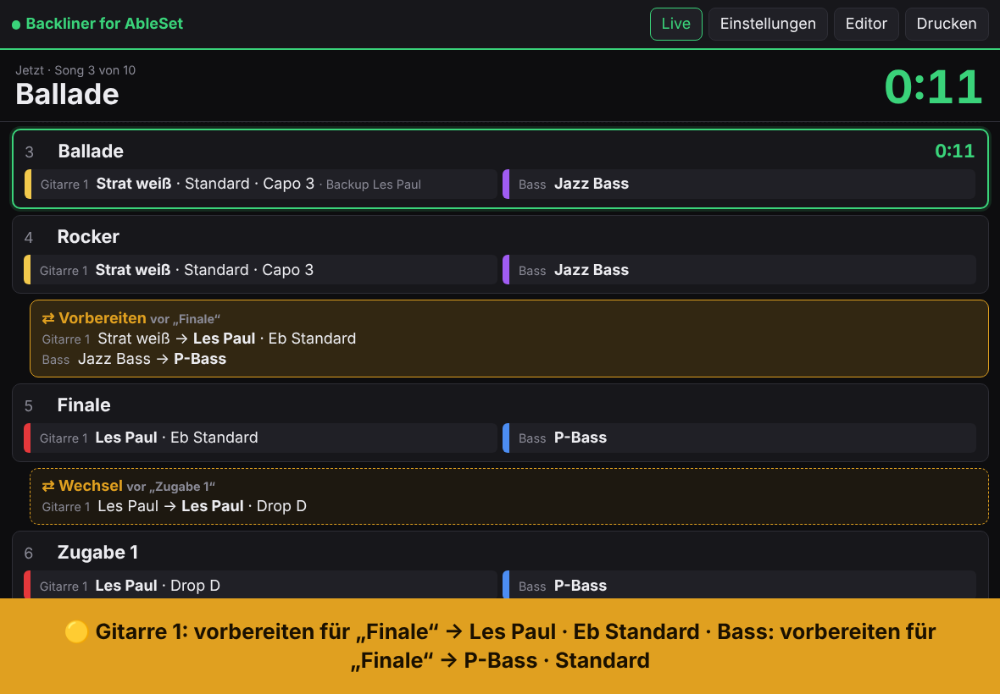

# Backliner for AbleSet

Setlisten-Ansicht für Backliner und Guitar Techs auf dem iPad – live gekoppelt an [AbleSet](https://ableset.app) in Ableton Live.

Die App läuft als kleines Menüleisten-Programm auf dem Show-Mac, holt sich den Status von AbleSet per OSC und zeigt auf jedem iPad im Browser, wer bei welchem Song welche Gitarre mit welchem Tuning und Capo spielt – mit Hinweisen, wann ein Wechsel vorbereitet und wann angereicht werden muss.

**📖 [Anleitung für die Crew](docs/ANLEITUNG.md)** – Einrichtung, iPads verbinden, Editor, Live-Betrieb, Updates und Lösungen für typische Probleme.



## Download

Die neueste Version gibt es unter **[Releases](../../releases/latest)**:

- `Backliner-for-AbleSet-x.y.z-universal.dmg` – zum Installieren (Intel und Apple Silicon)
- `Backliner-for-AbleSet-x.y.z-universal.zip` – wird vom Update-Button der App verwendet

Beim ersten Start: Rechtsklick auf die App → **Öffnen**, weil sie nicht von Apple signiert ist. Danach die Netzwerkfreigabe erlauben.

## Funktionen

- **Live-Liste** mit allen Songs, Gitarrenwechseln, AbleSet-Notizen und -Überschriften. Scrollt automatisch mit, kurz vorausschauen geht, nach ein paar Sekunden springt sie zurück.
- **Hinweise** pro Backliner einstellbar: „Vorbereiten“ X Songs vorher, „Gleich geht’s los“ X Sekunden vor Songende – pro Song überschreibbar.
- **Bis zu 4 iPads**, jedes betreut frei wählbare Musiker (z. B. als Vertretung).
- **Editor** für Musiker, Instrumente (Name + Farbe), Tuning, Capo, Backup-Gitarre und beliebig viele Notizfelder.
- **Wechsel im Song** an Abschnitten (z. B. ab der Bridge Les Paul) – die Abschnitte kommen direkt aus der Ableton-Projektdatei, mit eigenen Hinweisen und sekundengenauem Countdown.
- **Setlist-Änderungen** aus AbleSet werden übernommen und markiert, damit Wechsel geprüft werden können.
- **Daten im Ableton-Projektordner** (`Backliner/backliner.json`, mit Backups) – wie bei AbleSet.
- **Menüleisten-Symbol** mit Status, Restzeit, QR-Code für die iPads, Projektordner und Update-Button.
- **Druckbare Wechselliste** als Backup.

## Updates

Im Menüleisten-Symbol auf **Nach Updates suchen …** klicken. Die App lädt die neueste Version von GitHub, tauscht sich selbst aus und startet neu – die Daten bleiben erhalten. Beim Start prüft sie außerdem automatisch und meldet neue Versionen, installiert aber nie ohne Klick. Läuft gerade eine Show in AbleSet, warnt sie vorher.

## Neue Version veröffentlichen

1. Änderungen auf `main` bringen.
2. Einen Tag mit der Versionsnummer pushen, z. B. `git tag v1.6.1 && git push origin v1.6.1`
   – oder auf GitHub unter **Actions → Release → Run workflow** die Versionsnummer eintragen.
3. GitHub baut die App auf einem Mac (ca. 5–10 Minuten) und legt DMG und ZIP als Release ab. Ab dann finden alle installierten Apps das Update.

## Entwicklung

```bash
npm install
npm start                    # Mac-App starten (Electron)
npm run server               # nur den Server starten, Oberfläche unter http://localhost:8080
node test/fake-ableset.js    # simuliertes AbleSet zum Testen ohne Ableton
npm run dist                 # DMG + ZIP lokal bauen (nur auf macOS)
```

Ohne Terminal: `DMG bauen.command` bzw. `Server direkt starten.command` doppelklicken.

| Datei | Inhalt |
| --- | --- |
| `server.js` | OSC-Anbindung an AbleSet, Datenhaltung, Web- und WebSocket-Server |
| `main.js` | Mac-App: Menüleisten-Symbol, Status-Fenster, Projektordner, Updates |
| `updater.js` | Update über GitHub Releases |
| `als.js` | Liest Songs, Abschnitte und Tempo aus der Ableton-Projektdatei |
| `public/` | Oberfläche für die iPads (Live-Liste, Einstellungen, Editor, Druck) |
| `icon-src/` | Icon-Vorlagen als SVG, `node icon-src/render-icons.js` erzeugt die PNGs |

Technik: Electron, Express, WebSocket, node-osc. AbleSet-Schnittstelle: [OSC-Dokumentation](https://beta.ableset.com/docs/osc).
