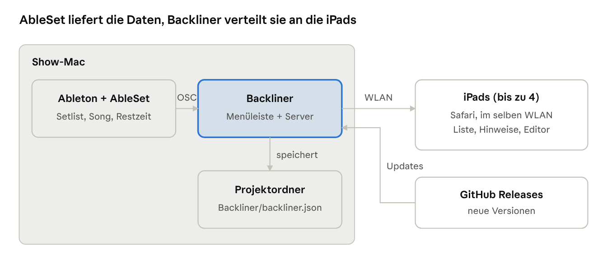
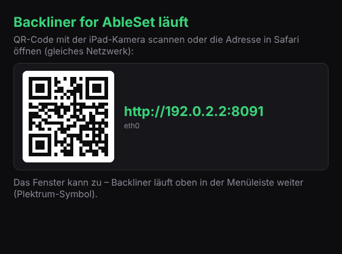
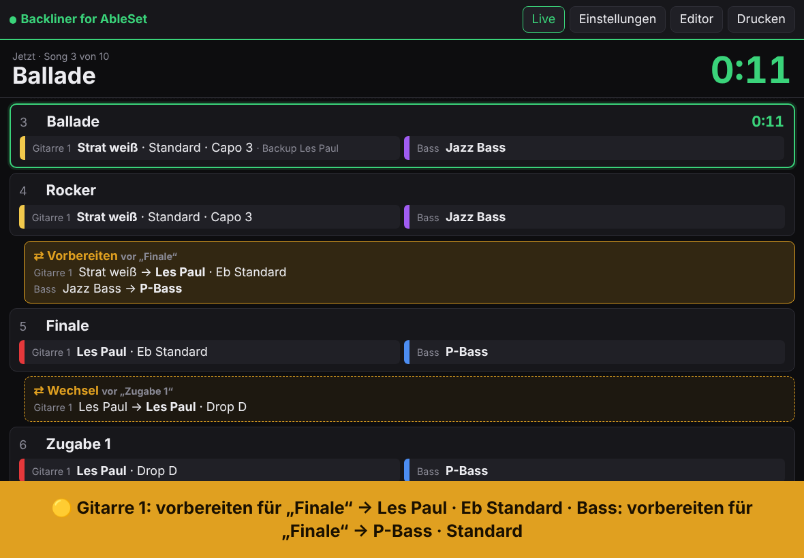

# Backliner for AbleSet – Anleitung

## Was Backliner macht

Backliner zeigt dir auf dem iPad live, welcher Musiker bei welchem Song welches Instrument mit welchem Tuning und Capo spielt, und sagt dir rechtzeitig, wann du vorbereiten und wann du auf die Bühne musst. Die Daten kommen aus AbleSet, du pflegst nur einmal die Zuordnungen.



Auf dem Show-Mac läuft Backliner neben AbleSet und holt sich per OSC den aktuellen Song und die Restzeit. Die iPads öffnen Backliner im Browser über das WLAN. Gespeichert wird im Ordner des Ableton-Projekts, Updates kommen von GitHub.

**Inhalt**

1. [Einrichtung auf dem Show-Mac](#1-einrichtung-auf-dem-show-mac)
2. [iPad verbinden](#2-ipad-verbinden)
3. [Daten pflegen im Editor](#3-daten-pflegen-im-editor)
4. [Live-Betrieb](#4-live-betrieb)
5. [Wo die Daten liegen](#5-wo-die-daten-liegen)
6. [Updates installieren](#6-updates-installieren)
7. [Probleme und Lösungen](#7-probleme-und-lösungen)

## 1. Einrichtung auf dem Show-Mac

Backliner läuft auf demselben Mac wie Ableton und AbleSet. Die Einrichtung dauert etwa fünf Minuten und ist nur einmal nötig.

1. Die neueste Version laden: [github.com/daave333/backliner-for-ableset/releases](https://github.com/daave333/backliner-for-ableset/releases/latest), dort die Datei mit der Endung **.dmg**.
2. Die DMG öffnen und **Backliner for AbleSet** in den Ordner **Programme** ziehen.
3. Beim ersten Start: **Rechtsklick** auf die App → **Öffnen** → noch einmal **Öffnen**. Das ist nötig, weil die App nicht von Apple signiert ist.
4. Die Frage nach eingehenden Netzwerkverbindungen mit **Erlauben** beantworten. Sonst erreichen die iPads den Mac nicht.
5. Es öffnet sich einmal ein Fenster mit QR-Code und Adresse für die iPads (Abschnitt 2).

Danach lebt Backliner oben rechts in der **Menüleiste** als Plektrum-Symbol, es gibt kein Dock-Symbol. Daneben steht die Restzeit des aktuellen Songs.

**Das Menü auf einen Blick**

| Menüpunkt | Wofür |
| --- | --- |
| 🟢 / 🔴 Status | Grün = AbleSet liefert Daten, rot = keine Verbindung |
| Projekt, Jetzt, Danach | Geladenes Ableton-Projekt, aktueller und nächster Song |
| iPad-Adresse kopieren | Adresse in die Zwischenablage, z. B. zum Weiterschicken |
| QR-Code für iPads anzeigen … | Fenster mit QR-Code zum Abscannen |
| Beim Anmelden automatisch starten | Für den Show-Rechner einschalten |
| Projektordner wählen … | Falls Backliner den Ordner des Ableton-Projekts nicht findet |
| Nach Updates suchen … | Siehe Abschnitt 6 |
| Backliner beenden | Server stoppen, iPads verlieren die Verbindung |

Voraussetzung: AbleSet läuft in der **Standard- oder Pro-Version**, denn nur diese bieten die OSC-Schnittstelle. Backliner meldet sich dort automatisch an, einstellen musst du in AbleSet nichts.

## 2. iPad verbinden

Jedes iPad öffnet Backliner einfach in Safari, eine App aus dem App Store braucht es nicht. Bis zu vier iPads können gleichzeitig verbunden sein.

1. Das iPad ins **selbe WLAN** wie den Show-Mac bringen.
2. Den **QR-Code** mit der Kamera scannen: am Mac über das Plektrum-Symbol → „QR-Code für iPads anzeigen …“ oder auf einem schon verbundenen iPad unter **Einstellungen → Weiteres iPad verbinden**.
3. In Safari auf **Teilen → Zum Home-Bildschirm**. Danach startet Backliner per Icon im Vollbild, ohne Adressleiste.
4. Unter **Einstellungen → Ich betreue heute** die Musiker ankreuzen, die du betreust. Fällt ein Kollege aus, kreuzt du seine Musiker einfach dazu.



**Was jedes iPad für sich einstellt**

Diese Einstellungen gelten nur für das eigene iPad, die Kollegen sehen davon nichts:

- Betreute Musiker
- Hinweis „Vorbereiten“: wie viele Songs vorher (Standard 1)
- Hinweis „Gleich geht’s los“: wie viele Sekunden vor Songende (Standard 30)
- Live-Ansicht als **Liste** oder **Karten**
- Rücksprung nach manuellem Scrollen (Standard 5 Sekunden)
- Schriftgröße klein, mittel oder groß und Layout quer oder hoch

Der Punkt oben links zeigt die Verbindung: **grün** = Daten von AbleSet kommen an, **rot** = keine Daten. Bricht das WLAN kurz weg, verbindet sich das iPad von selbst neu.

## 3. Daten pflegen im Editor

Im Tab **Editor** hinterlegst du einmal pro Produktion, wer was spielt. Änderungen werden sofort gespeichert und erscheinen auf allen iPads.

**Musiker und Instrumente**

1. **+ Musiker** anlegen und benennen, z. B. „Gitarre 1“, „Gitarre 2“, „Bass“.
2. Pro Musiker mit **+ Instrument** alle seine Instrumente anlegen.
3. Jedem Instrument eine **Farbe** geben. Die Farbe erscheint später als Balken in der Liste: gelb ist sofort „die weiße Strat“, ohne lesen zu müssen.

**Songs**

Die Songs kommen automatisch aus AbleSet, in der Reihenfolge der Setlist. Pro Song und Musiker trägst du ein:

| Feld | Beispiel | Hinweis |
| --- | --- | --- |
| Instrument | Les Paul | Auswahl aus den angelegten Instrumenten |
| Tuning | Drop D | Auswahlliste (Standard, Eb, Drop D, DADGAD …), eigene Tunings über „✎ Eigenes Tuning …“ |
| Capo | 3 | 1 bis 12, leer = kein Capo |
| Backup | Strat weiß | Ersatz, falls eine Saite reißt |
| Notizfelder | Übergabe am Steg | Beliebig viele über **+ Notizfeld** |

Ein **Wechsel** entsteht automatisch, sobald sich Instrument, Tuning oder Capo gegenüber dem vorherigen Song ändern. Du musst Wechsel also nicht selbst markieren.

**Wechsel im Song**

Spielt jemand innerhalb eines Songs ein zweites Instrument (z. B. Strat bis zum Refrain, ab der Bridge Les Paul), tippst du beim Musiker auf **+ Wechsel im Song**. Dann wählst du den Abschnitt, ab dem gewechselt wird, und Instrument, Tuning und Capo dafür. Es können mehrere Wechsel pro Song sein.

Die Abschnitte kommen aus AbleSet (die Locators im Song). AbleSet meldet sie nur für den gerade aktiven Song – Backliner merkt sie sich, sobald ein Song einmal aktiv war. Darum beim Soundcheck einmal durch die Setlist klicken; vorher ist der Knopf ausgegraut.

Im Song gibt es dieselben Hinweise wie zwischen Songs: **gelb**, solange der Wechsel im laufenden Song noch aussteht, **rot** mit Countdown, wenn der Abschnitt davor gleich endet (gleiche Sekunden-Einstellung wie bei Songs).

**Eigene Zeiten pro Song**

Rechts neben jedem Songnamen stehen zwei Felder: „Songs“ (Vorlauf für Vorbereiten) und „Sek.“ (Vorlauf für Gleich geht’s los). Leer gelassen gelten die Einstellungen des jeweiligen iPads. Für einen aufwendigen Umbau trägst du hier z. B. 2 Songs und 60 Sekunden ein, das gilt dann für alle.

**Druckliste**

Oben rechts auf **Drucken**: eine Tabelle mit allen Songs und Musikern, Wechsel sind fett und mit ⇄ markiert. Gut als Backup am Gitarrenständer, falls ein iPad ausfällt.

## 4. Live-Betrieb

Im Tab **Live** steht oben der aktuelle Song mit der Restzeit, darunter die ganze Setlist. Der laufende Song steht immer oben und ist grün umrandet.



**So liest du die Liste**

| Zeile | Aussehen | Bedeutung |
| --- | --- | --- |
| Song | Karte mit Nummer, darunter je Musiker ein Farbbalken | Was in diesem Song gespielt wird |
| Überschrift | grüne Großbuchstaben mit Linie, z. B. ZUGABENBLOCK | Abschnitt aus der AbleSet-Setlist |
| Notiz | bläuliche Zeile mit 🗒, z. B. „Ansage Band“ | Notiz aus der AbleSet-Setlist |
| Wechsel | gestrichelt eingerückt: „⇄ Wechsel vor …“ | Hier wechselt jemand Instrument, Tuning oder Capo |
| Wechsel im Song | in der Songkarte: „⇄ Im Song ab ‚Bridge‘ …“ | Wechsel an einem AbleSet-Abschnitt innerhalb des Songs |
| Vorbereiten | gelb hinterlegt | Wechsel steht in Kürze an, Instrument bereitlegen |
| JETZT WECHSELN | rot, blinkend | Song bzw. Abschnitt endet gleich, auf die Bühne und anreichen |
| Gespielt | ausgegraut | Liegt schon hinter euch |

Unten erscheint zusätzlich ein Balken: **gelb** zum Vorbereiten, **rot blinkend** mit Sekunden-Countdown zum Wechseln. Die Hinweise verschwinden von selbst, quittieren musst du nichts.

**Vorausschauen**

Wische ruhig nach unten, um zu sehen, was in den nächsten Songs kommt. Unten erscheint dann ein grüner Knopf mit Countdown. Nach 5 Sekunden ohne Berührung springt die Liste von selbst zurück zum aktuellen Song, ein Tipp auf den Knopf geht sofort.

**Wenn die Setlist umgestellt wird**

Werden in AbleSet Songs verschoben oder ausgetauscht, zieht Backliner sofort mit. Oben erscheint ein oranger Balken „Setlist geändert – Wechsel prüfen bei: …“ mit den betroffenen Songs, im Editor sind sie mit ⚠️ markiert. Prüfe dort kurz die Wechsel und tippe dann auf **Erledigt**.

**Notizen und Überschriften**

AbleSet meldet Notizen und Überschriften nur für den Song, der gerade läuft. Backliner merkt sie sich deshalb, sobald ein Song einmal dran war. Nach einem Durchlauf, etwa beim Soundcheck einmal durchklicken, ist die Liste vollständig und bleibt gespeichert.

## 5. Wo die Daten liegen

Wie AbleSet speichert Backliner seine Daten im Ordner des Ableton-Projekts. Lädst du in Ableton ein anderes Projekt, wechselt Backliner automatisch mit.

```
Dein Ableton-Projektordner/
├── Dein Set.als
├── AbleSet/            von AbleSet
└── Backliner/
    ├── backliner.json  Musiker, Instrumente, Zuordnungen, gelernte Notizen
    └── Backup/         ältere Stände mit Zeitstempel
```

**Neues Projekt einrichten**

Öffnest du ein Projekt zum ersten Mal, erscheint oben auf den iPads ein grüner Balken: „Neues Ableton-Projekt … Übernehmen aus [Produktion]“. Wähle die Produktion mit den passenden Daten und tippe **Übernehmen**, oder **Leer starten** für eine neue Show. Vorher schreibt Backliner nichts in den Projektordner.

**Wenn Backliner den Ordner nicht findet**

Backliner sucht den Ordner über die Mac-Suche nach der passenden .als-Datei neben einem AbleSet-Ordner. Klappt das nicht, steht in den iPad-Einstellungen ein Hinweis, und bis dahin wird in der zentralen Bibliothek gespeichert. Abhilfe: am Mac Plektrum-Symbol → **Projektordner wählen …** und den Ordner mit der .als-Datei auswählen. Die Zuordnung bleibt gespeichert.

**Backups und Zweitrechner**

Backliner legt höchstens alle 10 Minuten eine Sicherung in `Backliner/Backup` ab und behält die letzten 30. Kopierst du den Projektordner auf den Backup-Rechner, kommen die Backliner-Daten mit. Änderungen auf einem Rechner landen aber nicht automatisch auf dem anderen. Pflege die Daten deshalb immer auf demselben Rechner.

## 6. Updates installieren

Backliner prüft beim Start und alle 6 Stunden, ob es bei GitHub eine neue Version gibt. Installiert wird nie ohne deinen Klick.

1. Gibt es eine neue Version, kommt eine Mitteilung, und im Plektrum-Menü steht **⬆️ Update auf x.y installieren …**. Auf den iPads steht es unter Einstellungen → App-Version.
2. Klicken, die Neuerungen lesen, **Jetzt installieren** wählen.
3. Backliner lädt die neue Version, tauscht sich aus und startet neu. Die iPads verbinden sich nach ein paar Sekunden selbst wieder, alle Daten bleiben erhalten.

Von Hand prüfen: Plektrum-Symbol → **Nach Updates suchen …**. Die installierte Version steht direkt darunter.

**Nie während der Show.** Spielt AbleSet gerade, warnt Backliner vorher und „Später“ ist vorausgewählt. Am besten installierst du Updates vor dem Soundcheck.

## 7. Probleme und Lösungen

| Problem | Ursache | Lösung |
| --- | --- | --- |
| iPad zeigt „Keine Verbindung zum Server“ | iPad im falschen WLAN oder Backliner beendet | WLAN prüfen; am Mac muss das Plektrum-Symbol da sein, sonst Backliner starten |
| Punkt oben links ist rot | AbleSet liefert keine Daten | AbleSet und Ableton laufen? Nach einem AbleSet-Neustart dauert es bis zu 10 Sekunden |
| Seite lädt gar nicht | Netzwerkfreigabe am Mac abgelehnt | Systemeinstellungen → Netzwerk → Firewall → Backliner erlauben |
| „Port 8080 belegt“ im Menü | Backliner läuft doppelt oder ein anderes Programm nutzt den Port | Alle Backliner beenden, neu starten |
| Neues Projekt erscheint nicht | Projekt in Ableton noch nicht gespeichert | Projekt speichern; sonst „Projektordner wählen …“ |
| Notizen oder Überschriften fehlen | Song war noch nicht einmal dran | Einmal durch die Setlist klicken |
| Hinweise kommen nicht | Keine Musiker ausgewählt oder kein Wechsel eingetragen | Einstellungen → Ich betreue heute; im Editor Instrument, Tuning, Capo prüfen |
| Änderung „nicht gespeichert“ | In Ableton wurde währenddessen das Projekt gewechselt | Änderung noch einmal eintragen |
| App startet nach Update nicht | macOS blockiert die neue Version | Rechtsklick auf die App → Öffnen; sonst die DMG von GitHub neu installieren |

Fällt das iPad mitten in der Show aus, hilft die **gedruckte Wechselliste** (Abschnitt 3). Drucke sie vor jeder Show aus, wenn sich die Setlist geändert hat.
